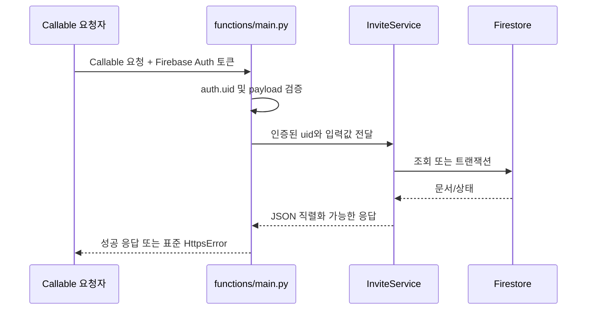

# Firebase Functions 서버 온보딩 가이드

이 문서는 친구 초대 기능의 Firebase 서버를 처음 다루는 팀원이 로컬 환경을 구성하고, 코드 흐름을 따라가며, 테스트와 배포 전 점검을 수행할 수 있도록 정리한 가이드입니다.

## 1. 기술 스택

| 구분 | 사용 기술 |
| --- | --- |
| 언어 | Python 3.14 |
| 실행 환경 | Cloud Functions for Firebase 2세대, `asia-northeast3` |
| API 형식 | Firebase Callable Functions (`on_call`) |
| 데이터베이스 | Cloud Firestore |
| 인증 | Firebase Authentication의 Callable 요청 `auth.uid` |
| 테스트 | pytest + Firebase Local Emulator Suite |

런타임은 루트의 `firebase.json`, Python 패키지는 `functions/requirements.txt`와 `functions/requirements-dev.txt`가 기준입니다.

## 2. 주요 파일 구조

```text
.
├── firebase.json                 # 함수 런타임, Firestore, Emulator 포트
├── .firebaserc                   # 기본 Firebase 프로젝트 ID
├── firestore.rules              # Firestore 보안 규칙
├── firestore.indexes.json       # 초대 목록 조회용 복합 인덱스
├── functions/
│   ├── main.py                  # Callable Function 진입점과 오류 변환
│   ├── requirements.txt         # 운영 의존성
│   ├── requirements-dev.txt     # 테스트 의존성 (운영 의존성 포함)
│   ├── run_tests.sh             # Emulator 기동을 포함한 전체 테스트
│   ├── scripts/invite-emulators.sh # 로컬 Emulator 시작·종료
│   ├── invite/
│   │   ├── constants.py         # 컬렉션명, 상태, 입력 제한
│   │   ├── errors.py            # 도메인 오류와 외부 오류 코드
│   │   ├── invite_codes.py      # 코드 생성, 정규화, 형식 검증
│   │   ├── services.py          # 비즈니스 로직과 Firestore 트랜잭션
│   │   └── time_util.py         # KST 일자 계산
│   └── tests/
│       ├── test_invite_codes.py # Emulator가 필요 없는 단위 테스트
│       └── test_invite_service.py # Firestore 통합/동시성 테스트
```

## 3. 요청 처리 흐름



`main.py`는 얇은 전송 계층입니다. 사용자 인증 UID 추출과 `InviteError` → `HttpsError` 변환만 담당합니다. 도메인 규칙은 `InviteService`에 두고, 다중 문서를 함께 바꾸거나 동시 요청에 민감한 작업은 Firestore 트랜잭션으로 처리합니다.

## 4. Callable API

| 함수 | 입력 | 핵심 결과 |
| --- | --- | --- |
| `initialize_invite_profile` | 선택 `nickname` | 고유 초대 코드 발급과 닉네임 초기 저장 |
| `update_invite_nickname` | `nickname` | 사용자 프로필과 기존 초대 문서의 닉네임을 함께 갱신 |
| `apply_invite_code` | `inviteCode` | 초대 관계 생성과 피초대자 grant 반환 |
| `get_invite_status` | 없음 | 초대 목록 반환 |
| `claim_invite_reward` | `grantId` | 초대자 보상을 `CLAIMED`로 변경 |
| `sync_invite_rewards` | 없음 | 서버 기준 수령 완료 grant 목록 반환 |

모든 함수는 Firebase Authentication이 필요합니다. 인증이 없으면 `UNAUTHENTICATED` 오류를 반환합니다.


## 5. Firestore 데이터 모델 (컬렉션 구조)

### `users/{uid}`

- `inviteCode`: 사용자의 고유 초대 코드
- `nickname`: 초대 기능에서 사용하는 기준 닉네임
- `dailyAttemptDate`: KST 기준 최근 입력 시도 일자
- `dailyAttemptCount`: 해당 일자의 입력 시도 횟수

### `inviteCodes/{code}`

- `uid`: 코드 소유자 UID

문서 ID 자체가 6자리 코드이므로 코드 중복을 트랜잭션에서 감지합니다.

### `invitations/{inviteeUid}`

- `inviterUid`, `inviteCode`
- `inviteeNickname`: 목록 조회를 위해 사용자 프로필에서 복제한 최신 닉네임
- `inviterRewardStatus`: `PENDING` or `CLAIMED`
- `createdAt`: 목록 정렬과 표시용 서버 타임스탬프

문서 ID를 피초대자 UID로 사용하므로 한 사용자는 하나의 초대 코드만 등록할 수 있습니다.

서버는 초대 관계와 보상 수령 상태를 저장합니다. `grantId`는 초대 문서 ID와 역할(`inviter` 또는 `invitee`)을 결합한 응답 값이며, 재화 수량이나 지갑 잔액은 Firestore에 저장하지 않습니다.

### Firestore 보안 규칙

- `users`, `inviteCodes`, `invitations` 컬렉션은 직접 쓰기가 차단되며, Callable Functions에서만 변경합니다.
- Python 서버 Functions에서만 사용하는 Firebase Admin SDK는 Firestore 보안 규칙을 적용받지 않습니다.
- `firebase.json`이 `firestore.rules`를 참조하므로 Emulator와 운영 배포가 같은 규칙 파일을 사용합니다.

## 6. 로컬 환경 준비

필수 도구:

- Python 3.14
- Node.js와 Firebase CLI
- Java 21 이상(Firestore Emulator 실행용)

저장소 루트에서 실행합니다.

```bash
python3.14 -m venv functions/.venv
functions/.venv/bin/python -m pip install -r functions/requirements-dev.txt
firebase --version
java -version
```

## 7. 서버 내 단위, 통합 테스트 실행

서버의 단위 테스트와 Firestore 통합 테스트를 모두 실행하려면 저장소 루트에서 다음 명령을 사용합니다.
현재 테스트는 `코드 생성 단위 테스트 3개`와 `기능 통합 테스트 11`개, 총 14개로 구성되어 있습니다.

```bash
./functions/run_tests.sh
```

이 스크립트는 Firestore Emulator를 시작하고 pytest를 실행한 뒤, 성공·실패와 관계없이 자신이 시작한 Emulator를 종료합니다. 실행 전에 Firestore Emulator의 8080 포트가 비어 있어야 합니다.


Emulator가 필요 없는 `코드 생성 단위 테스트`만 빠르게 실행하려면 다음 명령을 사용합니다.

```bash
functions/.venv/bin/python -m pytest functions/tests/test_invite_codes.py -q
```

테스트가 검증하는 주요 항목:

- 코드 형식, 혼동 문자 제외, 입력 정규화
- 코드 발급 멱등성과 중복 방지
- 닉네임 필수 프로필과 수정 시 초대 목록 동기화
- 정상 등록 및 자기 코드/없는 코드/잘못된 코드 거부
- KST 기준 일일 5회 제한
- 보상 소유권 및 중복 수령 방지
- 상태 조회와 보상 동기화 응답
- 동시 요청 8건에서 초대 문서 1개 및 시도 횟수 1회 보장
- Firestore에 재화 필드가 저장되지 않음

## 8. 변경할 때 지켜야 할 흐름

1. Callable API 계약과 서버 응답 필드를 먼저 확인합니다.
2. 도메인 로직은 `services.py`, 전송 계층은 `main.py`에 둡니다.
3. 동시 요청 또는 두 문서 이상이 관련된 변경은 Firestore 트랜잭션으로 구현합니다.
4. 실패 경로도 일일 시도 횟수 같은 정책에 포함되는지 확인합니다.
5. 단위/통합 테스트를 추가하고 `./functions/run_tests.sh`를 실행합니다.
6. 새 복합 쿼리가 있으면 `firestore.indexes.json`을 함께 수정합니다.
7. 새 Firestore 컬렉션이 있으면 `firestore.rules`을 갱신하고, 기존 밸런스 정책 경로의 권한이 바뀌지 않았는지 확인합니다.
8. 기능, API 계약, 데이터 모델, 테스트 방법이 바뀌면 이 온보딩 문서를 같은 변경에서 최신화합니다.
9. 배포 전 Functions 로딩과 응답 형식을 확인합니다.

## 9. 서버 배포

서버 코드 수정 후, 실제 운영 환경에 반영합니다.
Firebase CLI 로그인 후 저장소 루트에서 실행합니다. `--project`는 배포 대상 Firebase 프로젝트 ID입니다.

```bash
# 운영 규칙을 덮어쓰므로 기존 밸런스 정책 권한을 확인한 뒤 규칙·인덱스를 배포합니다.
firebase deploy --project solodevelopertraining --only firestore
# functions/main.py의 Callable Functions를 배포합니다.
firebase deploy --project solodevelopertraining --only functions
```

## 10. 배포 전 주의 사항

- `functions/firebase-debug.log`와 `functions/firestore-debug.log`는 생성 로그이며 커밋 대상이 아닙니다.
- 테스트 코드와 개발 전용 파일은 서버 코드와 같은 Python 환경을 사용하기 위해 `functions/`에 두되, `firebase.json`의 `ignore` 목록으로 운영 배포물에서는 제외합니다.
- 운영 배포 명령은 실제 프로젝트를 변경하므로 프로젝트 ID와 대상 환경을 확인한 담당자만 실행합니다.

## 11. 자주 겪는 문제

### 통합 테스트가 Emulator 오류로 실패함

`pytest`를 직접 실행하지 말고 `./functions/run_tests.sh`를 사용합니다. 8080 포트를 다른 프로세스가 쓰고 있는지도 확인합니다.

### `DefaultCredentialsError`가 발생함

최신 테스트 코드는 로컬 익명 자격 증명을 사용합니다. 오래된 테스트 코드나 다른 Firestore 클라이언트에서 `firebase_admin.firestore.client()`를 직접 생성하면 ADC를 요구할 수 있습니다.

### Emulator 포트가 4001, 4401 등으로 바뀜

다른 Firebase Emulator Suite가 이미 실행 중인 상태입니다. 중복 프로세스를 종료하고 한 인스턴스만 실행합니다.

### 쿼리에 인덱스가 필요하다는 오류가 발생함

`inviterUid ASC + createdAt DESC` 인덱스가 `firestore.indexes.json`에 있는지 확인합니다. 새 쿼리라면 오류가 안내하는 인덱스를 코드 리뷰와 함께 추가합니다.
