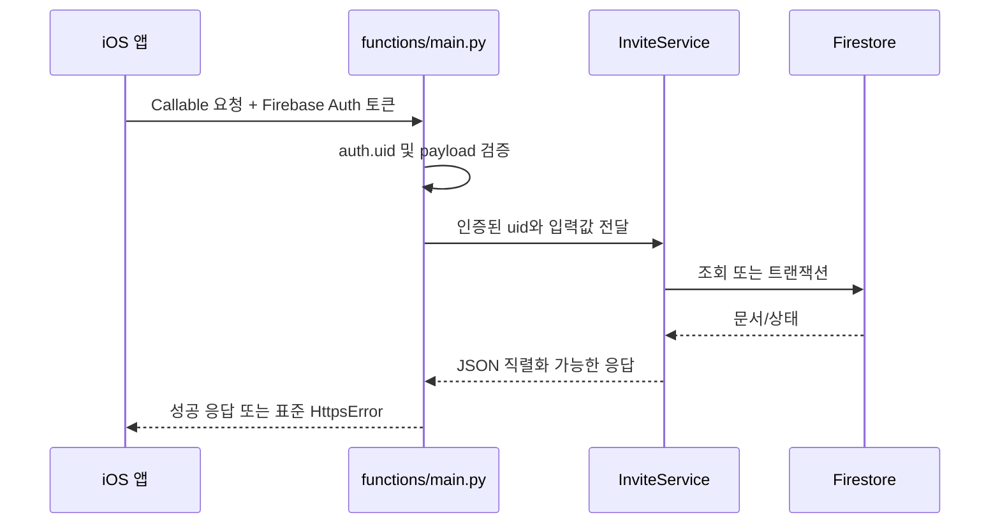

# Firebase Functions 서버 온보딩 가이드

이 문서는 친구 초대 기능의 Firebase 서버를 처음 다루는 팀원이 로컬 환경을 구성하고, 코드 흐름을 따라가며, 테스트와 배포 전 점검을 수행할 수 있도록 정리한 가이드입니다.

## 1. 기술 스택

| 구분 | 사용 기술 |
| --- | --- |
| 언어 | Python 3.14 |
| 실행 환경 | Cloud Functions for Firebase 2세대, `asia-northeast3` |
| API 형식 | Firebase Callable Functions (`on_call`) |
| 데이터베이스 | Cloud Firestore |
| 인증 | Firebase Authentication의 Callable 요청 `auth.uid` |
| 테스트 | pytest + Firebase Local Emulator Suite |
| iOS 연동 | Swift, Firebase Functions SDK |

런타임은 루트의 `firebase.json`, Python 패키지는 `functions/requirements.txt`와 `functions/requirements-dev.txt`가 기준입니다.

## 2. 주요 파일 구조

```text
.
├── firebase.json                 # 함수 런타임, Firestore, Emulator 포트
├── .firebaserc                   # 기본 Firebase 프로젝트 ID
├── firestore.rules              # 클라이언트 Firestore 접근 규칙
├── firestore.indexes.json       # 초대 목록 조회용 복합 인덱스
├── functions/
│   ├── main.py                  # Callable Function 진입점과 오류 변환
│   ├── requirements.txt         # 운영 의존성
│   ├── requirements-dev.txt     # 테스트 의존성 (운영 의존성 포함)
│   ├── run_tests.sh             # Emulator 기동을 포함한 전체 테스트
│   ├── invite/
│   │   ├── constants.py         # 컬렉션명, 상태, 입력 제한
│   │   ├── errors.py            # 도메인 오류와 외부 오류 코드
│   │   ├── invite_codes.py      # 코드 생성, 정규화, 형식 검증
│   │   ├── services.py          # 비즈니스 로직과 Firestore 트랜잭션
│   │   └── time_util.py         # KST 일자 계산
│   └── tests/
│       ├── test_invite_codes.py # Emulator가 필요 없는 단위 테스트
│       └── test_invite_service.py # Firestore 통합/동시성 테스트
└── SoloDeveloperTraining/SoloDeveloperTraining/
    ├── Production/Invite/
    │   └── InviteFunctionsClient.swift # iOS Callable API 어댑터와 응답 파싱
    ├── Production/Data/DTOs/InviteDTO.swift # 서버 응답 DTO, 상태·역할 enum
    ├── Production/Data/Repository/DefaultInviteRepository.swift # DTO 변환
    ├── GameCore/Data/Repository/InviteRepository.swift # 앱 모델 인터페이스
    ├── GameCore/Models/Systems/
    │   └── InviteSystem.swift       # 초대 현황 조회, 보상 동기화·수령
    └── App/Storages/
        └── InviteRewardGrantStorage.swift # 로컬 지갑 중복 반영 방지
```

## 3. 요청 처리 흐름



`main.py`는 얇은 전송 계층입니다. 사용자 인증 UID 추출과 `InviteError` → `HttpsError` 변환만 담당합니다. 도메인 규칙은 `InviteService`에 두고, 다중 문서를 함께 바꾸거나 동시 요청에 민감한 작업은 Firestore 트랜잭션으로 처리합니다.

## 4. Callable API

| 함수 | 입력 | 핵심 결과 |
| --- | --- | --- |
| `initialize_invite_profile` | 선택 `nickname` | 고유 초대 코드 발급과 닉네임 초기 저장 |
| `update_invite_nickname` | `nickname` | 사용자 프로필과 기존 초대 문서의 닉네임을 함께 갱신 |
| `apply_invite_code` | `inviteCode` | 초대 관계 생성과 피초대자 grant 반환 |
| `get_invite_status` | 없음 | 초대 목록 반환 |
| `claim_invite_reward` | `grantId` | 초대자 보상을 `CLAIMED`로 변경 |
| `sync_invite_rewards` | 없음 | 서버 기준 수령 완료 grant 목록 반환 |

모든 함수는 Firebase Authentication이 필요합니다. 인증이 없으면 `UNAUTHENTICATED` 오류를 반환합니다.

앱은 최초 닉네임 설정 뒤 초대 코드 팝업이 열릴 때 클라이언트에서 검증된 닉네임을 `initialize_invite_profile`에 전달합니다. 확인 버튼에서는 프로필 초기화를 다시 보장한 뒤 `apply_invite_code`를 호출합니다. 서버는 닉네임 형식을 다시 검증하지 않고 저장합니다. 닉네임이 저장되지 않은 사용자가 초대 코드를 적용하면 `NICKNAME_REQUIRED`를 반환합니다.

닉네임 변경 시 `update_invite_nickname`을 호출합니다. 이 함수는 사용자 프로필과 초대 목록의 닉네임을 한 트랜잭션에서 갱신합니다.

## 5. Firestore 데이터 모델

### `users/{uid}`

- `inviteCode`: 사용자의 고유 초대 코드
- `nickname`: 초대 기능에서 사용하는 기준 닉네임
- `dailyAttemptDate`: KST 기준 최근 입력 시도 일자
- `dailyAttemptCount`: 해당 일자의 입력 시도 횟수

### `inviteCodes/{code}`

- `uid`: 코드 소유자 UID

문서 ID 자체가 6자리 코드이므로 코드 중복을 트랜잭션에서 감지합니다.

### `invitations/{inviteeUid}`

- `inviterUid`, `inviteCode`
- `inviteeNickname`: 목록 조회를 위해 사용자 프로필에서 복제한 최신 닉네임
- `inviterRewardStatus`: `PENDING` 또는 `CLAIMED`
- `createdAt`: 목록 정렬과 표시용 서버 타임스탬프

문서 ID를 피초대자 UID로 사용하므로 한 사용자는 하나의 초대 코드만 등록할 수 있습니다.

`users/{uid}.nickname`이 닉네임의 기준 데이터이고 invitation의 값은 조회 성능을 위한 복제본입니다. 현재 사용자당 피초대 invitation이 최대 하나이므로 닉네임 수정 시 두 문서를 직접 갱신할 수 있습니다.

서버는 다이아 수량이나 지갑 잔액을 저장하지 않습니다. 응답의 grant는 지급 사실과 역할만 표현하며, 현재 재화 반영은 iOS 로컬 저장소가 담당합니다.

`Production/Data/DTOs/InviteDTO.swift`의 DTO는 서버 응답 필드를 표현합니다. 서버는 `grantId`와 역할(`inviter`, `invitee`)만 반환하며 재화 수량은 저장하지 않습니다. Repository는 코드 적용과 보상 수령에는 `grantId`를, 동기화에는 `grantId`와 역할을 전달합니다. iOS가 `InviteConstants`로 수량을 정해 로컬 지갑에 반영합니다. 수령 상태는 `InviteRewardStatus`(`PENDING`, `CLAIMED`), 역할은 `InviteRewardRole`로 파싱하며, 알 수 없는 값은 응답 오류로 처리합니다. `InvitedFriend`는 서버 정보와 로컬 반영 기록을 조합한 화면 모델입니다. 초대 코드 팝업은 `InviteSystem`을 호출하며, `InviteSystem`이 Repository 요청과 로컬 보상 기록을 관리합니다.

iOS는 서버의 grant 역할을 `InviteConstants`의 로컬 보상 수량으로 변환합니다. `InviteRewardGrantStorage`는 반영한 grant ID를 iOS `UserDefaults`에 저장합니다. 이를 통해 앱이 서버의 `CLAIMED` 상태를 다시 동기화해도 같은 보상을 로컬 지갑에 중복 지급하지 않도록 합니다. 지갑 데이터 형식과 기존 밸런스 Firestore 문서는 변경하지 않습니다.

### Firestore 보안 규칙

- `users`, `inviteCodes`, `invitations` 컬렉션은 iOS가 Firestore로 직접 쓰지 못하며, Callable Functions에서만 변경합니다.
- Python 서버 Functions에서만 사용하는 Firebase Admin SDK는 Firestore 보안 규칙을 적용받지 않습니다.
- `firebase.json`이 `firestore.rules`를 참조하므로 Emulator와 운영 배포가 같은 규칙 파일을 사용합니다.

## 6. 로컬 환경 준비

필수 도구:

- Python 3.14
- Node.js와 Firebase CLI
- Java 21 이상(Firestore Emulator 실행용)

저장소 루트에서 실행합니다.

```bash
python3.14 -m venv functions/.venv
functions/.venv/bin/python -m pip install -r functions/requirements-dev.txt
firebase --version
java -version
```

`.firebaserc`의 기본 로컬 프로젝트 ID는 `solodevelopertraining`입니다. Emulator 테스트에는 실서비스 자격 증명이나 ADC가 필요하지 않습니다. 테스트 클라이언트는 `AnonymousCredentials`로 로컬 Firestore에만 연결됩니다.

## 7. 서버 내 단위, 통합 테스트 실행

서버의 단위 테스트와 Firestore 통합 테스트를 모두 실행하려면 저장소 루트에서 다음 명령을 사용합니다.
현재 테스트는 `코드 생성 단위 테스트 3개`와 `기능 통합 테스트 11`개, 총 14개로 구성되어 있습니다.

```bash
./functions/run_tests.sh
```

이 스크립트는 Firestore Emulator를 시작하고 pytest를 실행한 뒤, 성공·실패와 관계없이 자신이 시작한 Emulator를 종료합니다. 초대 스킴으로 Firestore Emulator를 실행 중이라면 먼저 종료해 8080 포트를 비워야 합니다.

일반 `pytest`만 실행했을 때 Emulator가 없으면 통합 테스트는 더 이상 조용히 skip되지 않고, 올바른 실행 명령을 포함한 오류로 실패합니다.

Emulator가 필요 없는 `코드 생성 단위 테스트`만 빠르게 실행하려면 다음 명령을 사용합니다.

```bash
functions/.venv/bin/python -m pytest functions/tests/test_invite_codes.py -q
```

테스트가 검증하는 주요 항목:

- 코드 형식, 혼동 문자 제외, 입력 정규화
- 코드 발급 멱등성과 중복 방지
- 닉네임 필수 프로필과 수정 시 초대 목록 동기화
- 정상 등록 및 자기 코드/없는 코드/잘못된 코드 거부
- KST 기준 일일 5회 제한
- 보상 소유권 및 중복 수령 방지
- 상태 조회와 보상 동기화 응답
- 동시 요청 8건에서 초대 문서 1개 및 시도 횟수 1회 보장
- Firestore에 로컬 지갑/재화 필드가 저장되지 않음

## 8. iOS 앱에서 초대 흐름 테스트

초대 코드를 반복 입력하거나 보상 수령 전후 상태를 초기화하기 쉽도록, 개발 중 초대 테스트 데이터는 Emulator에서 관리합니다.

개발자의 초대 기능 테스트에는 iOS Simulator와 `SoloDeveloperTraining-InviteLocal` 스킴을 사용합니다. 이 스킴의 Debug 실행에서만 별도 FirebaseApp의 Auth·Functions를 로컬 Emulator에 연결합니다. 기본 `SoloDeveloperTraining` 스킴과 TestFlight는 운영 Firebase에 연결합니다.

### 실행 환경과 준비

| 실행 방식 | 초대 인증·API·저장 DB | 밸런스 정책 |
| --- | --- | --- |
| `SoloDeveloperTraining-InviteLocal` + Debug Simulator | Auth·Functions·Firestore Emulator | 기존 운영 Firestore 조회 |
| 기본 `SoloDeveloperTraining` 스킴 | 운영 Firebase | 기존 조회 방식 |
| TestFlight | 운영 Firebase | 기존 조회 방식 |

6절의 Python 가상환경·Firebase CLI·Java 설치를 완료하면 `SoloDeveloperTraining-InviteLocal` 스킴을 빌드하거나 실행할 때 Build Pre-action이 Auth·Functions·Firestore Emulator를 자동으로 시작하고 준비를 기다립니다. 이미 실행 중인 서비스는 재사용합니다. Xcode를 닫아도 Emulator 프로세스는 유지되며, 아래 명령은 이 스크립트가 시작한 서비스만 종료합니다.

```bash
functions/scripts/invite-emulators.sh stop
```

Auth는 `127.0.0.1:9099`, Functions는 `127.0.0.1:5001`을 사용하며, Emulator에 연결할 수 없을 때 운영으로 전환하지 않습니다. 로컬 Functions는 Firestore Emulator(`127.0.0.1:8080`)에 초대 데이터를 저장합니다. 세 서비스를 함께 실행해야 합니다. Firestore만 먼저 실행 중인 경우에도 시작 스크립트가 Functions에 `FIRESTORE_EMULATOR_HOST`를 전달합니다.

기존 밸런스 정책은 기본 FirebaseApp을 통해 운영 Firestore에서 계속 읽습니다. 따라서 앱 전체의 오프라인 테스트를 보장하지 않습니다. TestFlight 테스트에서 생성한 초대 데이터 역시 운영 DB에 남습니다.

두 스킴은 같은 Bundle ID를 사용하므로 같은 Simulator에서 번갈아 실행하면 로컬 유저·재화·보상 기록이 공유됩니다. 현재는 초대 테스트 전용 Simulator를 사용하고 운영 연결 앱과 섞어 실행하지 않습니다.

### 초대 흐름 확인

1. Xcode에서 `SoloDeveloperTraining-InviteLocal` 스킴과 초대 테스트 전용 첫 번째 iOS Simulator를 선택해 실행합니다.
2. 닉네임을 설정하고 초대 코드 입력을 건너뛴 뒤 튜토리얼을 완료합니다.
3. 홈의 친구 초대 팝업에서 내 초대 코드를 확인합니다.
4. 다른 익명 UID를 사용하는 두 번째 Simulator에서 앱을 실행하고, 닉네임 설정 후 첫 번째 Simulator의 초대 코드를 입력합니다.
5. 웰컴 보상과 튜토리얼 완료 후 다이아 지급을 확인합니다.
6. 첫 번째 Simulator를 다시 활성화해 친구 닉네임과 초대 현황을 확인하고 보상을 수령합니다.
7. 앱을 다시 활성화해 같은 보상이 중복 지급되지 않는지 확인합니다.

앱 시작 시 Firebase 익명 인증을 시도한 다음 밸런스 정책을 로드합니다. 초대 코드 입력은 로컬에서 형식만 확인하고, 코드 존재 여부·자기 코드·중복 등록·일일 제한은 서버 응답을 기존 팝업의 결과 문구로 표시합니다.

초대 코드 입력 화면부터 확인하려면 새 Simulator를 사용하는 것이 확실합니다. 앱 삭제만으로 Firebase 인증 정보까지 초기화된다고 가정하지 않습니다.

### 테스트 데이터 확인과 초기화

- [Emulator UI](http://127.0.0.1:4000)에서 Auth 테스트 사용자와 Firestore의 `users`, `inviteCodes`, `invitations`를 확인합니다. 실제 재화는 앱 로컬에서 관리합니다.
- 위 실행 명령은 데이터를 내보내거나 불러오지 않습니다. 터미널에서 `Ctrl+C`로 종료하고 다시 실행하면 서버 테스트 데이터를 새로 시작할 수 있습니다.
- 서버 데이터 초기화는 앱의 로컬 유저·재화·보상 기록을 지우지 않습니다. 처음부터 재현하려면 새 테스트 Simulator를 사용하거나, 테스트 전용 Simulator의 `Erase All Content and Settings`로 앱·인증 정보를 함께 초기화합니다. 후자는 해당 Simulator의 모든 데이터를 지웁니다.
- 7절의 서버 자동 테스트도 Firestore의 8080 포트를 사용합니다. 앱 수동 테스트용 Emulator를 종료한 뒤 `./functions/run_tests.sh`를 실행합니다.

## 9. 변경할 때 지켜야 할 흐름

1. 외부 API 계약을 먼저 확인합니다. iOS 파서는 `InviteFunctionsClient.swift`에 있습니다.
2. 도메인 로직은 `services.py`, 전송 계층은 `main.py`에 둡니다.
3. 동시 요청 또는 두 문서 이상이 관련된 변경은 Firestore 트랜잭션으로 구현합니다.
4. 실패 경로도 일일 시도 횟수 같은 정책에 포함되는지 확인합니다.
5. 단위/통합 테스트를 추가하고 `./functions/run_tests.sh`를 실행합니다.
6. 새 복합 쿼리가 있으면 `firestore.indexes.json`을 함께 수정합니다.
7. 새 Firestore 컬렉션이 있으면 `firestore.rules`을 갱신하고, 기존 밸런스 정책 경로의 권한이 바뀌지 않았는지 확인합니다.
8. 기능, API 계약, 데이터 모델, 테스트 방법이 바뀌면 이 온보딩 문서를 같은 변경에서 최신화합니다.
9. 배포 전 Functions 로딩과 iOS 응답 파싱을 함께 확인합니다.

## 10. 배포 전 주의 사항

- `functions/firebase-debug.log`와 `functions/firestore-debug.log`는 생성 로그이며 커밋 대상이 아닙니다.
- 테스트 코드와 개발 전용 파일은 서버 코드와 같은 Python 환경을 사용하기 위해 `functions/`에 두되, `firebase.json`의 `ignore` 목록으로 운영 배포물에서는 제외합니다.
- 운영 배포 명령은 실제 프로젝트를 변경하므로 프로젝트 ID와 대상 환경을 확인한 담당자만 실행합니다.

## 11. 자주 겪는 문제

### 이전 로컬 테스트 후 운영 정책 조회가 실패함

과거 기본 FirebaseApp에 Auth Emulator를 연결했던 Simulator에는 앱 재설치 후에도 Emulator 인증이 Keychain에 남을 수 있습니다. 초대용 FirebaseApp을 분리해도 기본 인증은 자동 삭제되지 않으므로, 정책 조회가 이 인증의 토큰을 가져오다가 실패할 수 있습니다.

이 경우 새 테스트 Simulator를 사용하거나, 문제가 발생한 테스트 전용 Simulator에서 `Device > Erase All Content and Settings`를 실행한 뒤 앱을 다시 설치합니다. 초기화하면 해당 Simulator의 모든 앱·데이터·인증 정보가 삭제됩니다. 앱 삭제·재설치 또는 Emulator 서버 데이터 초기화만으로는 Keychain이 정리되지 않을 수 있습니다.

### 통합 테스트가 Emulator 오류로 실패함

`pytest`를 직접 실행하지 말고 `./functions/run_tests.sh`를 사용합니다. 8080 포트를 다른 프로세스가 쓰고 있는지도 확인합니다.

### `DefaultCredentialsError`가 발생함

최신 테스트 코드는 로컬 익명 자격 증명을 사용합니다. 오래된 테스트 코드나 다른 Firestore 클라이언트에서 `firebase_admin.firestore.client()`를 직접 생성하면 ADC를 요구할 수 있습니다.

### Emulator 포트가 4001, 4401 등으로 바뀜

다른 Firebase Emulator Suite가 이미 실행 중인 상태입니다. 중복 프로세스를 종료하고 한 인스턴스만 실행합니다.

### 쿼리에 인덱스가 필요하다는 오류가 발생함

`inviterUid ASC + createdAt DESC` 인덱스가 `firestore.indexes.json`에 있는지 확인합니다. 새 쿼리라면 오류가 안내하는 인덱스를 코드 리뷰와 함께 추가합니다.
